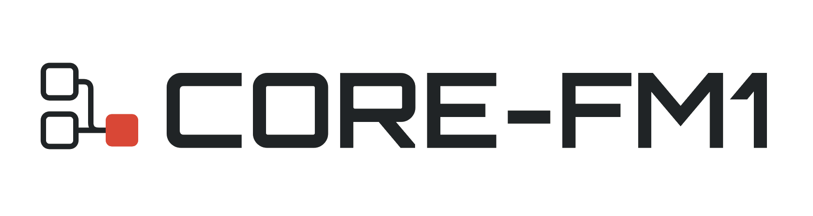

<p align="center">
  <picture>
    <source media="(prefers-color-scheme: dark)" srcset="assets/logo-dark.png">
    <source media="(prefers-color-scheme: light)" srcset="assets/logo-light.png">
    
  </picture>
</p>

<p align="center"><strong>Your FM-1. Your combination.</strong></p>

A modular firmware framework for the M-VAVE FM-1 synthesizer, inspired by
[Felucca](https://github.com/hugelton/Felucca),
[Melodee](https://github.com/keremimo/melodee), and
[SLOOP](https://github.com/isod89/sloop-fm1). The goal: build
one firmware image configured for your instrument.

> **Early development:** the minimal firmware builds and has emulator boot tests.
> It displays a boot screen; audio, engine mixing, and musical workflows are
> still being integrated. Hardware validation is pending.

## Modular by design

The aim is to configure **any compatible combination of supported modules**
from one source tree:

- **Mix your engines.** Combine synthesis engines across firmware lineages in
  the same build, with a shared engine interface.
- **Choose your workflow.** Select audio, effects, sequencer, MIDI, and storage
  implementations as their integration becomes available.
- **Build only what you need.** Enable the modules you use and save your choices
  in a configuration you can rebuild and share.

These are the integration goals. Combinations must fit the FM-1's memory and
processing budget and satisfy module dependencies. UI code stays coupled to
its firmware lineage until those dependencies are separated.

Kconfig provides the configuration menus and generates the C definitions used
by the build. Modules are selected when compiling the firmware. Today, only
the `minimal` preset is buildable; the Melodee, Felucca, and SLOOP presets and
engine selection are planned.

## Build the current milestone

Install [mise](https://mise.jdx.dev/getting-started.html), then run from this
checkout:

```sh
mise trust
mise install
mise exec -- uv sync --locked
mise exec -- task config:defconfig -- minimal
mise exec -- task build
```

The build downloads the SDK and JieLi toolchain when needed and writes
`build/core-fm1.fwsc`. On first use, Task asks you to trust its remote setup
Taskfiles. The compiler runs on x86-64 Linux; macOS builds use Docker, and
supported ARM Linux setups use QEMU.

To inspect the build without compiling, run `mise exec -- task build:dry-run`.
To explore the configuration menus, run `mise exec -- task config`. Some menu
choices are placeholders: the build rejects unintegrated options. Reload
`minimal` to return to the supported configuration.

## Test and contribute

```sh
mise exec -- task test:unit
mise exec -- task test:e2e
```

The E2E suite builds the firmware and checks it in the browser emulator.
See [Testing](docs/TESTING.md) for Chromium setup, test coverage, and screenshots.

Help integrate an engine or subsystem, define its compatibility requirements,
or add tests for a supported combination. Include the configuration and test
results with your contribution, and retain upstream credits and license notices.
Start with the [configuration](Kconfig), [firmware entry point](firmware/src/core_fm1.c),
and [build tasks](Taskfile.yml).

For playable firmware available today, explore the
[FM-1 community catalog](https://github.com/aroum/fm1-custom-fw).

## Credits and license

Built on the work of **hugelton** (Felucca), **keremimo** (Melodee), and
**isod89** (SLOOP), with **aroum** maintaining the community firmware catalog.

[GPL-3.0-only](LICENSE). Components with other licenses retain their notices;
see [Third-party components](THIRD_PARTY.md).
