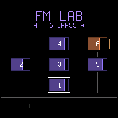
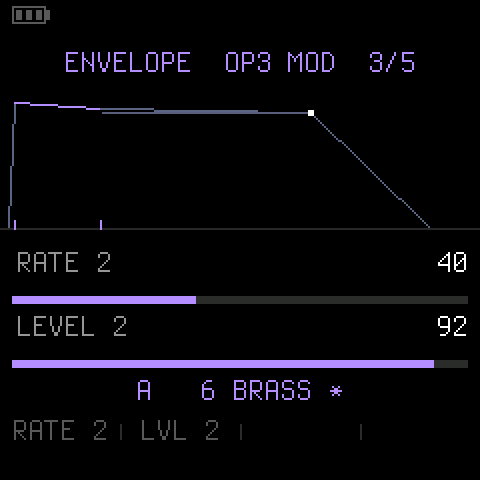
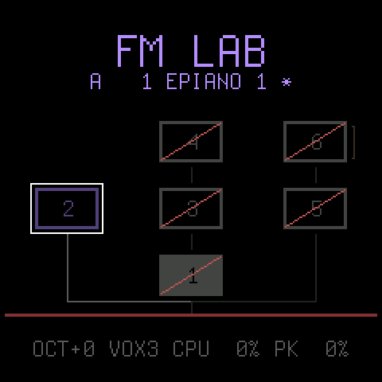
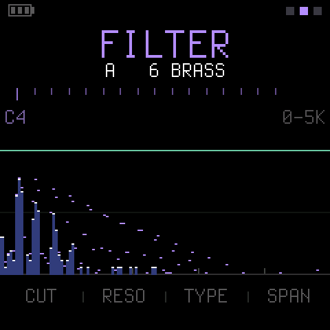
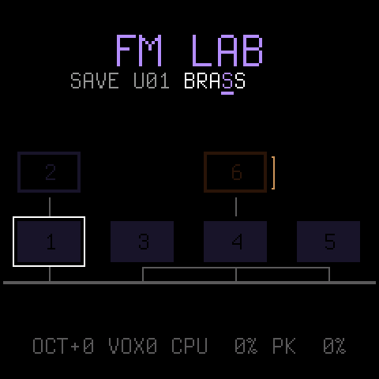

<p align="center"></p>

# FM Lab

**A six-operator FM synthesizer for the M-VAVE FM-1, built to learn FM on.**

Most of the custom firmwares for the FM-1 turn it into a groovebox. This one goes the other way: no sequencer,
no drums, no pattern chaining. One instrument, the real DX7 engine behind it, and every parameter under a knob
with the sound still playing. You turn something, you hear what it did, and the screen tells you what it was.

```
firmware/src/fmlab.c      <- the instrument: voices, the panel, the editor, the screen
firmware/src/dx7_core.c   <- the FM engine: 6 operators, 32 algorithms, Dexed's maths in fixed point
firmware/src/dx7_voice.h  <- the 156-byte voice: pack, unpack, sanitise, and the range of every parameter
firmware/src/dx7_voices.h <- the factory voices, generated by tools/gen_voices.py
firmware/src/platform.c   <- the plumbing (boot, USB, updates, audio ISR, settings), from Dinghy, untouched
```

FM Lab is built on [Dinghy](https://github.com/zvenson/dinghy) (zvenson), whose platform is
[Felucca](https://github.com/hugelton/Felucca) by Leo Kuroshita (Hügelton Instruments) as
[SLOOP](https://github.com/isod89/sloop-fm1) (isod89) carries it. The FM engine is the one from
[dxsloop](https://github.com/zvenson/dxsloop), which is Sven Trogus's integer port of
[Dexed](https://github.com/asb2m10/dexed) / Google's `music-synthesizer-for-android`.

<p align="center"> </p>

> **Status: runs on the FM-1.** Measured on the device: 8 voices of six operators cost about 26 % of the audio
> ISR's budget, and editing while eight notes sound costs nothing on top of that. See
> [tests/cpu_baseline.txt](tests/cpu_baseline.txt).

## The instrument

**8 voices**, each a full six-operator DX7: 32 algorithms, feedback, per-operator envelopes and keyboard
scaling, the pitch envelope, the LFO. Notes come from the keys or from USB-MIDI on any channel. When all eight
are busy the oldest released note goes first, then the oldest held one.

**20 factory voices** to start from, each designed to show one thing — what feedback does, what a 7:1 ratio
sounds like, how an algorithm with four carriers differs from one with one. None of them are Yamaha's or
M-VAVE's; they are written out in `tools/gen_voices.py`, which is the readable source for all of them.

**32 user slots** after them, in flash, for your own sounds and for other people's — a DX7 bank is 32 voices,
so a bank fills them exactly.

## Playing it

| | |
| --- | --- |
| **The keys** | 27 of them, F3 to G5. **OCT-** / **OCT+** move it two octaves either way; the button lights for a shift that way and pulses once you are at the end of the travel. A key stops the note it started, so changing octave mid-chord does the right thing. |
| **PRESETS** | The voice. It changes under anything still sounding, so you can hold a chord and walk through the bank. 20 factory voices, then your 32, numbered `U01` to `U32`. |
| **SAVE** | Keep the sound you are on, under a name of your own. Press, name it and pick the slot, press again. Any other button backs out. |
| **HOME** | Two screens, and pressing it again swaps them: the algorithm drawn out, or the spectrum of what you are hearing. |
| **MONO / POLY** | The top two black keys, on the OPERATOR page. Mono is one voice, last note wins. |
| **A / B** | The voice line starts with the side you are listening to. **PLAY** flips it, **REC** copies this side onto the other. |

## Editing it

The five buttons along the top are the pages. The knobs under the screen are whatever that page shows;
when a page has more than fits, the header says `2/4` and there are two ways to the rest: **SEL**, which is
the shorter reach once your hands are on the knobs, or pressing that page's own button again — the button
that got you there also walks you through it, and wraps around to the start. On **EDIT**, **ENV** and
**LFO** that second press is a hold rather than a tap, for the reason the next section but one gives.

A strip along the bottom of every screen names what the four knobs are doing, in the order they sit under
it. On a parameter page that is the four parameters you can see anyway — but it is in the same place on
every page, so the habit of glancing there always pays off, and on the pages that draw something rather
than list it (the spectrum, the envelope) it is the only label there is. Six characters is all a knob gets,
which is why some of the names are squeezed: `RT SCL` is the rate scaling, `PMSENS` the LFO's pitch mod
sensitivity, `P LVL1` the first level of the pitch envelope.

### What a click is worth

Almost every number on a DX7 is a byte from 0 to 99, and one click of one of those is not a thing you can
hear. At a click a detent that is a hundred clicks of wrist to cross a range, which is the wrong resolution
for the question you actually ask most of the time while you are still learning — *what is down the other
end of this?* So a click is worth **five**, and **SEL** is a shift key: hold it and you get the single step
back for landing on a value. The knob names at the bottom of the screen go lilac while it is held, so the
fine step is something you can see rather than something you have to remember.

Only the 0–99 bytes move in fives. Everything else on the instrument is a list of choices rather than a
range — the thirty-two algorithms, the ratios, the curves, **DETUNE**, **TRANSPOSE**, the switches — and a
click there is already worth exactly one meaningful thing, so it stays one. Jumping five algorithms at a
time would not be faster, only harder to aim.

**SEL** keeps its old job. It still steps to the next four things on a plain tap — but the tap you were
using as a shift does not count, because the knob you turned under it has spoken for the press. Otherwise
every reach for a precise value would dump you on a different bank.

### The knobs on HOME

HOME has no parameters to list, but it is the screen you are looking at while you are actually listening, so
the knobs are not idle there. They move four operators at once — `LVL 1` through `LVL 4` to begin with — and
**SEL** steps which four, the same thing **SEL** means everywhere else: the next four things under the knobs.
There are four sets, `LVL 1-4`, `LVL 5 6`, `RAT 1-4`, `RAT 5 6`, and then it comes round again. The two sets
that run past operator six leave those knobs blank rather than pretend.

This is the balancing view, and balancing the operators against each other is most of what making an FM sound
turns out to be. A modulator's level is how hard it modulates, so sweeping `LVL 2` with a note held is the
brightness of the sound in one gesture — and you can watch operator 2's box fill as you do it, or watch the
sidebands spread on the spectrum. Turning a ratio from the same place is the other half: the shape of the
sound rather than the amount of it.

With a note held the boxes already tell you where you are. With nothing playing they cannot, so the line under
the title says what moved instead — `OP1 LVL 69`, or `OP3 x2.00` — for a second and a half.

| Button | Page | What is on it |
| --- | --- | --- |
| **HOME** | | the algorithm diagram, or the spectrum — press **HOME** again to swap them; the knobs move four operators at a time |
| **EDIT** | OPERATOR | hold for the page: level, ratio, detune, mode, velocity sensitivity, amp mod, the coarse and fine bytes, the keyboard scaling — or tap it to put `LEVEL RATIO DETUNE` under the knobs without leaving HOME |
| **ENV** | ENVELOPE | hold for the page: the envelope drawn to scale, attack, decay, sustain and release, then the four raw segments a rate and level at a time — or tap it for `ATK DEC SUS REL` without leaving HOME |
| **LFO** | LFO | hold for the page: the LFO drawn over speed, delay and wave, then pitch mod, amp mod and pitch mod sensitivity, then key sync — or tap it for this operator's `A M SENS` without leaving HOME |
| **GLO** | GLOBAL | algorithm, feedback, oscillator key sync, transpose, the pitch envelope and **SPECTRUM** |
| **FX** | FILTER | hold for the page: the filter's curve over cutoff, resonance and type — or tap it for `CUT RESO TYPE` without leaving HOME |

### Ratio, and the two bytes under it

The DX7 sets an operator's pitch with two numbers: a coarse multiplier, and a fine one that stretches it by
up to another ninety-nine per cent. Between them they can say nearly anything, and they are miserable to
read — `COARSE 2 FINE 0` and `COARSE 1 FINE 99` are a semitone apart and look nothing alike, and the thing
you actually want to say, *twice the key*, is spread across two rows.

**RATIO** says it in one number. It steps a list: the whole multiples up to 31, which are the harmonics and
the reason FM can sound like an instrument rather than a clang; the halves between the low ones; and 1.41,
which is in there because an operator at the square root of two is the quickest way to hear what
*inharmonic* means. Nothing is stored differently — it is those same two bytes, so a sound edited here is
still a DX7 voice and still exports as one, and a ratio the list does not reach is still shown faithfully
if a patch arrives using it.

Switch **MODE** to `FIXED` and the same two bytes stop being a multiple of the key and become a frequency
instead, anywhere from 1 Hz to about 9.8 kHz. The row follows: it is called `FIXED HZ`, it says the
frequency, and the knob walks it. An operator pinned to a frequency ignores what you play, which is how
most bells and all of the breath and click at the front of a sound are made.

### A tap, and a hold

**EDIT**, **ENV**, **LFO** and **FX** can be pressed two ways, and the only difference is how long you hold
them.

**Hold** either for a moment and you get its page, which is what those buttons have always done. Once you
are there, pressing it again — tap or hold, it no longer matters — walks that page's banks of parameters and
wraps round, exactly as every other page button does. **HOME** is the way back out.

**Tap** one and you stay on HOME — on the diagram, on the spectrum, on the sound — but the four knobs become
that page's first few rows for a single operator. **EDIT** gives you `LEVEL`, `RATIO` and `DETUNE`; **ENV**
gives you `ATK`, `DEC`, `SUS` and `REL`. The fourth knob under **EDIT** is deliberately blank: it is being
kept for the operator's waveform. **LFO** gives you one knob, `A M SENS`, for the reason
[the LFO](#the-lfo) gives. **FX** gives you the whole of [the filter](#the-filter), which is three knobs.

The **EDIT** and **ENV** knobs are literally the first rows of the page the button would have opened,
driven by the same code that drives them there. A tap is a shortcut to the top of a menu, not a second set of
controls to learn, and anything you change this way is on the page waiting for you when you hold the button
instead.

The operator is the one **SELECT** is on — the one with the white ring round its box in the diagram — and
tapping the same button again steps to the next one. So do the `OP1` to `OP6` black keys. Press **HOME** to
leave.

This is the view worth living in. Four operator parameters under four knobs, a note held, and the box and the
sidebands both moving while you turn: everything FM has to teach is in that loop, and it is much harder to
learn it from a list of numbers on a page with the sound two button presses away.

The title says when you are in it. `FM LAB` becomes `EDIT OP3`, `ENV OP3` or `LFO OP3`, and it needs to,
because part of the keyboard has stopped playing — which is the one thing about this that can take you by
surprise.

**SELECT** picks which operator the OPERATOR and ENVELOPE pages are showing. So do the low six black keys,
the ones the panel prints `OP1` to `OP6` under: on those two pages, and whenever a tap has the knobs, they
jump straight to their operator instead of sounding, because there you are pointing at an operator rather
than playing one. All six glow while they mean that, and the one you are editing is lit outright. On every
other page they are keys again.

The header names the operator and says whether it is a `CAR` or a `MOD` — whether, under the algorithm you
are on, you hear it directly or only feel it bending something else. Change the algorithm and watch that
word change; that is most of what FM is.

**ALGORITHM** is on its own knob and works from any page, so you can hold a note, keep your eyes on an
operator's envelope, and move it through all 32.

## One note at a time

The top two black keys are marked `MONO` and `POLY`, and on the OPERATOR page that is what they do. Both
glow there and the mode you are in is lit; the meter says `MONO` where it would otherwise count voices.

Mono is one voice with **last-note priority**. The newest key down is the one you hear, and letting it go
drops you back to the key still under your finger rather than to silence. The envelopes start again only
when nothing was already held — so a note played on its own gets its own attack, and a note slurred into
an existing one does not. There is no portamento: the pitch steps.

That distinction is worth more on an FM synth than it sounds. The attack is where most of the bright
modulation lives, so a slurred note is a different *timbre*, not just a different articulation — play a
bass line legato and then detached and the sound changes, not only the phrasing. It is one of the easiest
ways to hear what an operator's envelope is actually doing.

The switch belongs to the instrument and not to the voice. The DX7 format has no byte for it, and a bank
saved here should still be a real DX7 dump, so it lives with the octave and the current voice instead of
in the patch. Changing it stops anything sounding, which is the honest thing to do when the voice
allocator is being replaced underneath.

## One envelope over everything

Six operator envelopes are the honest way an FM voice is shaped. They are also six places to get one
fade-in wrong, and six things to learn before you can hear what any of them does. So there is one more
envelope that is not an operator's at all: a single ADSR over the finished voice, after the operators and
before the mix.

Press the black key marked `GLOBAL` — the one just above `OP6` — wherever `OP1` to `OP6` are already
selecting an operator: on the OPERATOR and ENVELOPE pages, or after a tap of **ENV** — or of **LFO**,
where it does the same for the LFO, as [the LFO](#the-lfo) describes. The title says
`ENV GLOBAL`, the four knobs become `ATK` `DEC` `SUS` `REL` for the whole voice, and any `OP` key takes you
back. On a tap of **ENV** the algorithm diagram steps aside and draws the envelope instead, because with
`GLOBAL` selected the diagram has nothing to point at and you should be able to see the shape you are
turning.

**It does not touch the timbre, only how much of it you hear, and that is the entire lesson.** Turn an
operator's `ATK` up and the note arrives dull and brightens as it goes. Turn this one up and the finished
sound — bright from the first instant — fades in with its brightness intact. Hearing those two next to each
other is the shortest route to understanding what makes FM different from a filter.

Times run from instant to two seconds, doubling about every nine clicks, and the cells say the time rather
than the byte: `45MS`, `311MS`, `1.3S`.

`REL` reads `OFF` at **both** ends of its knob, and `OFF` is where it starts. There it leaves the note alone
and the operators decide the tail, exactly as they did before this envelope existed — and with `ATK` at 0
and `SUS` at 99 as well, the whole thing is skipped outright, so it costs nothing at all. Turn `REL` on and
it takes the tail over instead: the operators are held in sustain underneath the fade rather than released,
which is the only way this envelope can make a note *longer* rather than only cutting it short. The price is
that the patch's own release is not heard while `REL` is on, and `OFF` at either end is the quick way to
refuse it. `DEC` reads `OFF` at the top only; its 0 means "drop straight to the sustain level", which is a
shape worth having and the only way to make a note start quiet.

It is a setting of the instrument and not of the sound, for the same reason mono is: the 156 bytes are a
DX7 voice and have no room for it, and a bank saved here should stay a real DX7 dump. So there is one of it,
it is saved with the octave, and it is under every voice you load.

## The LFO

The LFO is the one part of a DX7 voice where it is easy to set everything right and hear nothing, and the
reason is that its depth is split in two. `AMP MOD` is how hard the LFO swings, once, for the whole voice.
`A M SENS` is how much of that swing one operator takes, and there are six of it. **Both have to be up.** A
depth with every sensitivity at zero does nothing at all, and so does a sensitivity with no depth — which is
the single most common way of deciding the LFO is broken. Pitch works the same way, with `P MOD` the depth
and `P M SENS` the sensitivity, except that there is only one `P M SENS`: every operator's frequency comes
from the one pitch of the voice, so there is no way for one operator to have vibrato and another not.

The layout is built on that split. **Hold LFO** and the page is every LFO number there is one of, and
nothing else, so the black keys go on playing on all of it. It draws the LFO itself above three cells, four
cycles wide whatever the speed so the shape stays readable at both ends: a dim line for the LFO as it will
be, and a bright one at the height `DELAY` is letting through right now, with a dot riding it while a note
plays. With `DELAY` at 0 the two coincide; wind it up and the bright one starts flat and grows into the dim
one. The picture is computed with the engine's own LFO arithmetic, so it cannot disagree with what you hear.
The banks are `SPEED` `DELAY` `WAVE`, then `P MOD` `A MOD` `PMSENS` — the sensitivity beside the depths,
because `P MOD` means nothing without it — then `K SYNC`, which restarts the LFO under every new note. With
it off each voice keeps its own LFO running, so a chord shimmers rather than pulsing in step.

**Tap LFO** and you get the other half: one knob, the selected operator's `A M SENS`, with the `OP` keys
choosing which. One knob looks thin until you count what it is worth. Put a carrier's sensitivity up and
the LFO is tremolo. Put a modulator's up instead and the loudness barely moves but the brightness wobbles,
because a modulator's level is how hard it modulates. That difference is the thing worth finding out about
amplitude modulation on an FM synth, and this is the knob that finds it.

Press `GLOBAL` from there and the knobs become `SPEED` `DELAY` `P MOD` `A MOD` for the whole voice, the
title says `LFO GLOBAL`, and the LFO's picture takes the diagram's place, exactly as the envelope's does.
There is no operator to step any more, so a tap of **LFO** steps the wave instead and the picture changes
under it. Any `OP` key takes you back.

One quirk of the engine is worth knowing, because the instrument reproduces it faithfully rather than
hiding it. Any operator with `A M SENS` above zero loses about a tenth of its level even with `AMP MOD` at
zero: Dexed's sensitivity curve does not start at nothing. Raising a sensitivity with no depth is not
silent, only steady.

## The filter

A DX7 has no filter, and FM does not need one: a modulator's level already decides how bright a sound is. That
is exactly why there is one here. It is the other way of shaping a sound — the subtractive way, the way almost
every other synth works — sitting right next to the FM way, so you can hear what each is good at. Take the top
off a bright patch with `LOW PASS`, then try to get the same thing by turning a modulator down. The two sound
different, and why they do is a good part of what FM is: the filter only takes away partials that are already
there, while the modulator stops making them.

It is one filter on the finished sound, after every voice: `LOW PASS`, `BAND PASS` or `HIGH PASS`, or `OFF`,
which is where it starts and where it costs nothing at all. `CUT` runs from 20 Hz to 20 kHz evenly by
pitch, so a click is about half an octave, and the cells say the frequency it is at. `RESO` raises a peak at
the cutoff, from none at all to one about 21 dB tall, and the bottom half of the knob is the subtle half.

**Tap FX** and the three are under the knobs on HOME, with the filter's curve where the algorithm diagram was;
a second tap steps the type. Tap it on the spectrum screen instead and the curve is drawn in green over the
live sound, which is the best view of the three: the partials under the slope are the ones it is taking away,
and with `RESO` up you can watch one of them stand up as the peak crosses it. None of it is an operator's, so
the black keys go on playing. **Hold FX** for the FILTER page, the same curve above three cells. The curve is
the filter's own arithmetic rather than a sketch of a filter, so a peak is as tall on the screen as it is in
the sound.

Like [the global envelope](#one-envelope-over-everything) it belongs to the instrument and not to the voice,
so it is saved with the octave, it is under every voice you load, and a bank saved here stays a true DX7 dump.

## Taking it apart

You cannot hear what an operator does by reading its numbers. You hear it by taking it away and putting it
back, so four buttons do nothing but that.

| Button | |
| --- | --- |
| **ARP** | Switch the selected operator off, and on again. |
| **SEQ** | Solo it: every other operator off. Press again and all six come back. Its light stays on while *anything* is switched off, so you cannot forget. |
| **PLAY** | Switch to the other side of the A/B compare. Lit on **B**. |
| **REC** | Copy this side onto the other one, so there is something to come back to. |

The switches are not part of the voice — a DX7's were front-panel switches, not voice data — so they are not
saved, they survive an A/B switch, and changing voice brings all six back on.

**Solo a modulator and you hear nothing.** That is not a bug and it is worth sitting with: a modulator is
never heard, only felt. The diagram says so — the operator is alive, every carrier is struck through, and the
output bus at the bottom turns red to show that nothing is reaching it.

<p align="center"></p>

The way to use A/B is: land on a sound, press **REC** to copy it across, press **PLAY** to move to the other
side, change *one* thing, then flip back and forth. Hearing the same parameter two ways in succession tells
you far more than hearing it once. Each side carries its own voice number and its own `*`, so you can also
park a factory voice on one side and your edit of it on the other.

## The three drawings

**HOME draws the algorithm.** Every operator is a box, and every box fills from the left with how loud that
operator is *right now* — read straight out of the running voice, the same number the engine is about to
multiply by. The body of the fill is dim and the level itself is a bright edge riding on top of it, so two
operators a little apart are easy to tell apart. The orange box and the loop beside it is the one carrying
feedback. The white outline is the operator **SELECT** has picked, so you can see where the thing you are
editing sits before you edit it. An operator that is switched off is struck through in red, and its wires
fade out with it.

Hold one note and watch. The modulators empty out while the carrier is still half full, and that gap is
the whole reason an FM sound gets duller as it decays rather than just quieter. It is the envelope you
cannot hear, doing the thing you *can* hear. Nothing else on the instrument shows you that.

Which boxes are carriers is left to the wires: a carrier is one with a line running down to the output bar
along the bottom. The fill is worth more than the shading it replaced, because routing is a thing you can
read off the diagram at leisure and level is a thing that is gone in a second.

**One box is not a bar.** Tap **EDIT** or **ENV** and the operator the knobs land on draws its *envelope*
instead — the same curve the ENVELOPE page draws, shrunk into the box, ending in the bottom right-hand
corner. It is filled in solid rather than traced, because a shape thirty pixels wide does not read any
other way, and the part already played is the bright half, so the join between the two brightnesses is the
playhead. It gives up its number while it is doing this; the white ring has already said which operator it
is. That curve has LEVEL baked into it the same way the ENVELOPE page's does, so turning LEVEL with nothing
playing at all visibly collapses the shape — which is the one thing the bar could never show you, because
with no note held a bar is empty.

**HOME again draws the spectrum.** This is the one screen here purely to teach, and it is worth the stare.

<p align="center"></p>

FM makes its harmonics by a rule you can write down: a carrier at *fc* modulated at *fm* grows sidebands at
*fc* ± *k·fm*, and the number of them loud enough to matter grows with how hard you are modulating. That is
the whole of FM in one sentence, and it is almost invisible from the numbers on the other pages. Here it is a
row of evenly spaced lines that spreads outward as you raise a modulator's **LEVEL**. Hold a note, put your
other hand on that knob, and watch the sound get brighter and wider at the same time, because for FM those
are the same thing.

The axis is linear and not logarithmic, which is the point. A log axis would fit 20 Hz to 20 kHz on the screen
at once, but it squeezes the sidebands closer together the higher they go, and the even spacing is exactly the
structure worth seeing. The span is a setting rather than part of the sound, so it lives on **GLOBAL** as
`SPECTRUM` — 1, 2, 5, 10 or 20 kHz, named in the line underneath the drawing — which leaves all four knobs
here doing the same thing they do on the diagram. It is remembered across a power cycle.

The ticks along the top edge are whole multiples of the note you are playing, the first one taller and
brighter. Partials that line up with them are harmonic; partials that sit between them are not. That is the
difference between a **RATIO** of 2 and a **RATIO** of 2 with a little **DETUNE**, or between a ratio of 3
and a ratio of 3.5, and it is far easier to see than to hear. The ticks along the floor are the kilohertz, and
the two faint lines across the middle are 24 and 48 dB down from full scale — the bottom of the screen is 72.
The lilac marks are a peak that falls back slowly, so a plucked sound leaves its shape behind long enough
to read.

It analyses the output and not a single operator, which sounds like the lesser choice but is not: **ARP** and
**SEQ** already switch an operator off and solo one, so soloing a carrier gives you exactly that branch of the
algorithm, and nothing here has to make a second claim about what the engine is doing. What you see is what
you hear, always.

**ENV draws the envelope, to scale.** This is the part of a DX7 that catches everyone out: a *rate* is a
speed, not a time, so the same rate takes longer the further it has to travel, and four equal-looking rates
are nothing like four equal segments. The graph is stepped with the engine's own arithmetic, so the widths
are the real times and the heights are the real levels — in dB, which is how the levels are specified.

The first bank is **attack, decay, sustain and release**, one to a knob, which is the envelope every other
synth you have met describes. The four fit in a single row of cells under the graph, lined up with the knobs
that move them, and the graph takes the space that saves. **ENV** again — or **SEL** — walks on to the four
raw segments the DX7 actually stores, a rate and its level at a time, which is the pair that means something.
The segment you are on is picked out in colour; on the ADSR bank the whole envelope is, because there you are
moving all of it. The white dot is where the envelope of the selected operator has actually got to in the
note you are holding.

ADSR is a way of saying the eight bytes, not a replacement for them. Attack is rate 1 counted backwards —
the engine makes a bigger rate *faster*, which is upside down from every knob ever labelled attack, so the
page shows you `99` minus it. Decay is rate 2, and writes rate 3 to match, so a patch that draws its decay
in two stages still obeys one knob. Sustain is level 3, and writes level 2 to match, which flattens those two
stages into the single slope the knob implies. Release is rate 4. Level 1 and level 4 are deliberately left
alone: a patch that peaks below full, or releases to something other than silence, goes on doing so. Turn to
the raw banks at any time and you can see exactly what the four knobs did.

The voice name shows a `*` while you have changed anything. To throw an edit away, turn **PRESETS** off the
voice and back onto it — it is reloaded from the bank.

Nothing retriggers. Every edit is handed to the audio ISR, which recomputes the operators and leaves every
phase and envelope exactly where it stood — so a note you are holding bends into its new shape rather than
starting again.

## Keeping a sound

**SAVE** writes the voice you are on into one of the 32 user slots, under a name of your own. Press it and
the top line turns into `SAVE U01 BRASS`: the slot on the left, the ten characters of the name on the right,
one of them ruled underneath. Three knobs are live at once, so picking the slot and writing the name are the
same moment rather than two steps — **PRESETS** moves the slot, **SELECT** moves along the name, and
**ALGORITHM** sets the character you are on. Press **SAVE** again to write; press anything else to back out,
and the name you were typing goes with it.

<p align="center"></p>

The slot number is grey while the slot is still empty and accented once it holds something of yours, so the
one thing you cannot undo is visible without spending a word on it.

The name starts as the one the sound already has, which is the point of the whole thing: a patch you built
out of BRASS 1 and saved under the name BRASS 1 is a patch you will never find again. The character knob
offers a space, A to Z, 0 to 9 and `- . # +` — forty-one steps is a name you can type, ninety-five is not.
Space comes first, one detent back from A, which is how you clear the tail of a name shorter than ten.

The screen says `SAVED`, and the write costs about a tenth of a second of silence, because
programming flash on this chip means stopping the audio.

The bank lives in the last two 4 KiB sectors of the globals area, `0xFD000` and `0xFE000` — not in the main
store where the stock firmware keeps its samples, so putting the original firmware back finds everything
where it left it. A slot you have never written holds a DX7 INIT VOICE: a single sine on operator 1,
algorithm 1, which is the right place to start a sound from scratch.

## Sending it patches

The user slots take DX7 SysEx, which is the real reason for them: thirty years of DX7 patches are a download
away, and the fastest way to learn what these 155 numbers do is to open somebody else's and read it.

```
python tools/syx.py list   rhodes.syx     # what the file holds, without sending it
python tools/syx.py send   rhodes.syx     # file -> FM-1
python tools/syx.py get bank  mine.syx    # the 32 user slots -> file
python tools/syx.py get voice one.syx     # the voice on screen -> file
```

A **bulk dump** (32 voices, 4104 bytes) replaces all 32 slots at once and the screen says `BANK RECEIVED`. A
**single voice dump** lands in the editor with a `*`, unsaved, exactly as it would on a real DX7 — play it,
and press **SAVE** if you want to keep it. A dump with a bad checksum is refused outright and nothing in
flash is touched. The FM-1 also answers the two standard dump requests, so any librarian that can talk to a
DX7 can read its bank back.

One limitation worth knowing: the FM-1 holds **one** SysEx message at a time, so a file written as 32
back-to-back single-voice dumps — which many bank files found online are — will mostly be dropped. `syx.py`
paces them and tells you what the file is; a real bulk dump is the thing to send.

If you write your own librarian, note that RtMidi on Windows gives WinMM only 4 × 1024 bytes of SysEx input
buffer and drops a longer message *with no error at all* — the FM-1 says `BANK SENT` and nothing arrives.
`syx.py` talks to WinMM directly on Windows to get a buffer big enough for the 4104-byte bank.

No patches are shipped with FM Lab. The test bank in `tests/mksyx.py` is generated, not borrowed.

## The meter

**GLOBAL**'s very bottom line, below the knob legend, reads `OCT+0  VOX3  CPU 26% PK 33%`: the octave, how
many voices sound, how much of the audio ISR's budget the smoothed load is, and the worst single block since
the FM-1 was switched on. The ISR has 5804 µs to render 256 frames; over 100 % and it cannot keep up, at
which point FM Lab drops its quietest voice rather than glitch. It is there because the whole point is to
see the cost of what you are doing.

It lives on **GLOBAL** alone, so that it is out of the way while you are playing and programming. `PK` holds
until the FM-1 is switched off, so to measure something you cannot watch at the same time — the spectrum
screen, say — switch it on, do the thing, then come to **GLOBAL** and read it.

## The two corners

The top sixteen pixels belong to nothing else, so two small things live up there on every screen.

Top left is a battery, three bars. The last bar turns amber and an empty cell turns red, which is as much
warning as a synth needs. Plug the FM-1 into a computer or a charger and the bars cycle instead of holding
still: the chip has no charger status line to read, so "charging" is inferred from the USB device being
configured and not suspended, and an animation says *being charged* without pretending to know how far
along. Unplug it to get a reading.

The thresholds are 531, 561 and 591 raw ADC counts, and they are measurements rather than arithmetic — the
divider on PB1 and the converter's reference are both undocumented, so there is no volts figure to work
back from. They were derived on real hardware by [dxsloop](https://github.com/zvenson/dxsloop) and are
used here with credit in the source. The whole useful span is about sixty counts, which is why the reading
is smoothed hard before it is drawn.

Top right is a pair of pips for which HOME screen you are on. They appear on HOME only; every other page
already says `1/4` in its title, and repeating that would be noise.

## Building it

You need Linux on x86-64 (or macOS / Windows with Docker or WSL), Python 3 with Pillow, the JieLi toolchain
and three files of the JieLi AC79 SDK. Once:

```sh
pip3 install Pillow
tools/get_toolchain.sh                      # JieLi's clang for the chip, to ~/.jieli/toolchain
git clone --depth 1 --branch AC79NN_SDK_V1.2.1_2023-12-13 \
    https://gitee.com/Jieli-Tech/fw-AC79_AIoT_SDK.git ~/fw-AC79_AIoT_SDK
```

Then:

```sh
./build.sh                                  # -> build/fmlab.fwsc
tests/run_host.sh                           # -> build/host/fmlab.wav and screen PNGs, no FM-1 needed
```

On Windows, `tests/run_host.ps1` does the same with MSVC. On macOS the build runs the toolchain in a
`linux/amd64` Docker container by itself (have Docker running). `JIELI_TOOLCHAIN` and `AC79_SDK` point
elsewhere if your copies live somewhere else.

> Clone with LF endings. `.gitattributes` handles it, but a tree that was already checked out as CRLF will
> fail in the shell scripts with `set: Illegal option -`.

**Install** your build over USB from the command line (once: `pip3 install mido python-rtmidi`):

```sh
python3 tools/fm1_install.py build/fmlab.fwsc    # asks before it writes; restarts the FM-1 into FM Lab
python3 tools/fm1_install.py --info              # what runs on the connected FM-1
```

Hold **OCT-** while switching on for the USB rescue: no sound, only the updater. Two crashes at boot and the
FM-1 goes there by itself. Back to another firmware, or to the official one, with the
[FM-1 Firmware Hub](https://fm1.designburgapps.com) in Chrome or Edge. Installing firmware is at your own risk.

## Trying a change without the hardware

`tests/host.c` is the FM-1 on your computer: it runs the same `fmlab.c`, plays a scripted sequence of keys,
buttons and knob turns at it, and writes the sound as a WAV and the screen as PNGs. It fakes the flash and
the MIDI port too, so saving and SysEx work. The script built into `tests/host.c` holds a chord and edits it,
which is the thing most worth listening to. Twelve more scripts go with it:

```sh
tests/run_host.sh tests/algorithms.txt    # all 32 algorithms, drawn, one screenshot each
tests/run_host.sh tests/operators.txt     # the operator switches and the A/B compare, sound checked
tests/run_host.sh tests/bank.txt          # saving, and .syx in and out, data and sound checked
tests/run_host.sh tests/panel.txt         # the pages and the operator keys, screens and MIDI checked
tests/run_host.sh tests/spectrum.txt      # the analyser, against where the partials belong
tests/run_host.sh tests/levels.txt        # the operator boxes: five bars, and one envelope
tests/run_host.sh tests/edit.txt          # RATIO, against the two bytes underneath it
tests/run_host.sh tests/home.txt          # HOME's four knobs, against the bytes they move
tests/run_host.sh tests/env.txt           # ADSR, against the eight raw bytes it is a view of
tests/run_host.sh tests/focus.txt         # tap and hold, and what each one does to the knobs
tests/run_host.sh tests/fast.txt          # four clicks, against four clicks with SEL held
tests/run_host.sh tests/corners.txt       # the battery and the HOME pips, by the pixel
tests/run_host.sh tests/global.txt        # the envelope over the whole voice, screens and sound
tests/run_host.sh tests/lfo.txt           # depth against sensitivity, by ear; the page, the tap, GLOBAL
tests/run_host.sh tests/fx.txt            # the filter, harmonic by harmonic; the page, the tap, the overlay
```

`tests/wavcheck.py` is the one that keeps the switches honest: under algorithm 16, which has a single
carrier, switching that carrier off or soloing any of the modulators has to produce *exact* silence, and an
A/B flip has to come back to a sample-identical sound.

`tests/syxcheck.py` does the same for the bank: a voice sent in has to be the bytes that land in flash, a
dump sent back has to be the bytes in flash, a bad checksum has to change nothing, and a voice saved and
reloaded has to be a sample-identical sound. It also checks the naming: a name typed at the save prompt has
to reach flash with the sound and nothing else about the sound may change, and a save backed out of halfway
has to leave no trace of the letters that were typed. `tests/mksyx.py` generates the patches it uses.

`tests/panelcheck.py` checks the panel without looking at it. A black key that picks an operator has to send
*nothing* — the run's own MIDI log is the evidence — while a key that is still a key has to send a note on
and the matching note off, including one held across a page change. The screens it compares byte for byte,
all 240 rows of them — the CPU meter would drift with the machine, but it lives on **GLOBAL** now and this
test never goes there, so even the knob legend along the bottom is compared: walking a page's banks has to
give two different screens and then the first one back, and arriving at a page from elsewhere has to start
it over. Mono it checks by ear, so to speak — a chord in mono has to be a third of the same chord in poly, a
slurred note has to come in at what is left of the one before it rather than at a fresh attack, and letting
go of the newer of two held keys has to fall back to the older one instead of to silence.

`tests/speccheck.py` reads the analyser off the screen and checks it against arithmetic done elsewhere. A
bar's top is drawn in white and nothing else on that screen is, so the white pixels give the height of every
column. Hold C4 — 261.63 Hz — at a span of 5 kHz and its fundamental belongs at column 12.6, its second
harmonic at 25.1 and its third at 37.7; widen the span to 10 kHz and every one of them has to move to half
the distance across. That is a claim about FM, about the axis and about the transform all at once, and it is
only true if all three are right. It also checks that the bars fall when you let go and that the held peaks
outlive them, and that HOME really does swap between two screens and back.

`tests/envcheck.py` tests a translation, so it reads both languages and checks they agree. It drives the
four ADSR knobs to known numbers, then walks on to the raw banks and reads the bars there. Attack plus rate 1
has to come to ninety-nine, which is only true if the inversion is the right way round; rate 3 has to equal
rate 2 and level 2 has to equal level 3, which is only true if the twin writes landed; and level 1 and level
4 have to be exactly where the preset left them, which is only true if ADSR kept its hands off them. It reads
the ADSR values off the four cells and the raw ones off the full-width bars, so a layout that put a value
under the wrong knob would fail too.

`tests/homecheck.py` has nothing on the screen to read, because HOME draws no parameter rows. It proves the
wiring from the far end instead: turn KNOB1 thirty steps down on HOME, walk out to the EDIT page, and the bar
that draws operator one's level has to be sixty-nine pixels narrower — thirty ninety-ninths of the two
hundred and twenty-eight it spans. A vague claim that something changed would have been worth much less. It
also reads the knob legend: four sets stepped by **SEL** and back to the first, the same four on both HOME
screens, and the sets that run past operator six leaving those two cells genuinely empty.

`tests/levelcheck.py` does the same trick for the operator boxes. The outline, the dim body of the fill and
the bright level edge each have a colour of their own and nothing else on the diagram uses them, so counting
pixels is enough to say what every box is doing. Hold a plucked note and the fill has to fall, shot after
shot; let go and every box has to empty while staying drawn, which is also the proof that a carrier is an
outline now rather than a solid block. It checks that the feedback operator keeps its warm colour and its
loop, and that six boxes side by side under algorithm 32 stay six separate boxes of equal width — the live
redraw patches one box at a time, and that is what would break first if a patch grew. Then the box that is
not a bar: tap **EDIT** with nothing sounding, and exactly one box may have anything in it. That one has to
be filled solid to the floor in every column it occupies, has to reach the bottom right-hand pixel, has to
have lost its number while the other five keep theirs — and turning **LEVEL** alone has to lower its crest.
Every one of those is a claim a bar could not make, since a bar with no note held is empty.

`tests/editcheck.py` reads a number off every parameter row. The bar under a value is its amount drawn as a
width in pixels, so a screenshot of a page is four numbers, and the claims about **RATIO** can be arithmetic
rather than "the screen changed": one click is one entry, turning back down retraces the same entries
exactly, both ends of the list hold against another click, and `FIXED` switches the same knob to counting
frequency steps — coarse 31, of which the engine reads only the low two bits, has to land three decades up.
Then the claim that matters. It drives **RATIO** to each end of its list and goes and reads `COARSE` and
`FINE` directly, two banks along: `x0.50` has to be 0 and 0, `x31.00` has to be 31 and 0. If **RATIO** were
anything other than those two bytes, that is where it would show.

`tests/fastcheck.py` reads the same bars to do arithmetic on a feel: four clicks move **LEVEL** by twenty,
and the same four with **SEL** held move it by four, which is a fifth and not merely less. That the coarse
step is kept off the lists is proved next door rather than here — `tests/edit.txt` walks **RATIO** one
entry a click with **SEL** nowhere near it, and would fail outright if fives had been applied to a list. It
also checks the two halves of **SEL** not colliding: letting go after a turn leaves the page alone, and
letting go without one still steps the bank.

`tests/cornercheck.py` counts pixels in a sixteen-pixel band. It drives the battery through four charge
states and measures the lit bars — forty-five pixels, thirty, fifteen, none — then checks the cell's
outline goes grey, amber, red at the right counts. It counts two pips, confirms the right one is the lit
one, presses **HOME** and confirms the lit one moved, and goes to a page to confirm both are gone. Last
and least obvious, it changes page twice and checks the corners are still there afterwards: the drawing is
cached behind a signature so it is cheap, and a full-screen clear has to invalidate that cache or the
corners vanish for good. That is a whole class of bug in this firmware, so it is worth a check of its own.

`tests/globalcheck.py` is the one that checks a feature it cannot see all of at once, so it argues from
both ends. On screen: the `GLOBAL` key repaints the title and the cells and takes the page's other banks
away; the graph's attack edge moves right as `ATK` goes up and its held stretch drops as `SUS` comes down;
the cells say times rather than bytes; `REL` at 0 draws the same cell as `REL` at 99, because both are
`OFF`; and on HOME the curve that marks the selected operator goes from 205 pixels to none, because the
diagram has given its room to the envelope.

In the sound: the same chord twice, once with the envelope idle and once under a 424 ms attack, measured
as RMS 30 ms in and again at the end of the attack. Then a third chord to prove the thing the pictures
cannot show — that with `REL` on the note is still sounding half a second after the key came up, where the
patch's own release had finished in a third of that, and that it stops when the fade reaches the bottom
rather than hanging a voice open.

That last group is the reason the audio checks exist at all. They were green on the first run, which is
what established the engine was right before a single pixel had been argued about — and they stayed green
through a bug that made every time twice what the screen said, which is a fair warning about what a
relative measurement can and cannot tell you.

`tests/focuscheck.py` tests a distinction the script can only make with a stopwatch, so the host harness had
to learn what a button is. It used to deal in edges; now `btn 4` is a fifty-millisecond tap and `btn 4 600`
is held down for six hundred, with the button genuinely down in between, which is what the firmware now
needs to see. The checks are the two halves of the difference: a tap must leave the diagram on the screen
while renaming the banner and relabelling all four knob cells, and a hold must replace the screen entirely.
Then it proves the knobs really are the page's rows and not a copy of them — `ATK` turned to 40 has to read
as rate 1 of 59 when you go and look at the raw bank — that two operators get different numbers, that the
fourth **EDIT** cell is genuinely empty rather than stale, that **HOME** hands the knobs back, and, from the
run's own MIDI log, that the `OP` keys sent nothing while a white key played and sounded normally.

`tests/lfocheck.py` makes the claim the LFO section rests on by playing the same note three times — depth
up and nobody listening, both up, sensitivity up and no depth — under algorithm 16, whose only carrier is
`OP1`, and dividing the outer two into the first so that the patch's own decay cancels. Only the middle one
may move, and it does: down to one per cent of itself and back, against a swing of 1.01 for the third. The
statistic took finding. Ten-millisecond RMS windows hear the partials beating against each other as much as
the LFO, and a window a whole cycle long hides the LFO completely; ten-millisecond windows averaged three at
a time, a fifth of a cycle, tell the two notes apart by seventy times. It also pins the engine quirk above:
the third note has to sit steady between eight and nine and a half tenths of the first.

The layout it checks from the audio as much as the screen, because a key that points makes no sound. The
black keys have to play on the LFO page's banks and fall silent under a tap; `GLOBAL` has to swap the knobs,
the title and the picture, a second tap there has to change the picture and not the knobs, and an `OP` key
has to put everything back. Changing the wave has to change the plot, and changing it back has to give the
same pixels — which is what says the picture is a function of the bytes. Last, it walks to OPERATOR 2/4 and
reads `A M SENS` off its own row, full, which proves the one knob under the tap wrote that operator's byte.

`tests/fxcheck.py` measures the filter on one steady note, `ORGAN` on middle C, by the level of its
harmonics: once with the filter off, and then through each setting, so that the voice cancels out and the
difference is the filter. `LOW PASS` at 230 Hz has to keep the fundamental within a dB and take more than
20 dB off the eighth harmonic, two octaves up; `HIGH PASS` at 1.86 kHz has to do the opposite; `LOW PASS` set
right on a partial has to leave it 3 dB down, which is what a cutoff means; and full `RESO` there has to stand
it up by more than 15 dB without touching the fundamental. It measures 26, 46, 2.9 and 24. On the screen, a
tap has to swap the diagram for the curve and a second tap change the curve and not the knobs; `OFF` has to
draw nothing in the curve's colour; the curve has to appear over the spectrum and go again with **HOME**; and
the page has to be three cells under the curve, with one bank, so its own button leaves it where it is.

## Where to go next

- **[docs/API.md](docs/API.md)**: everything `platform.c` gives you — the panel's ids, the screen calls, the
  audio contract, MIDI, settings, the flash map, timing.
- **[docs/RULES.md](docs/RULES.md)**: the chip's rules (no FPU, no libgcc, the audio ISR's budget) and what the
  build checks for you.
- **[tests/cpu_baseline.txt](tests/cpu_baseline.txt)**: what the engine costs, how it was measured, and what
  should make you measure it again.

## License

GPL-3.0-only. The FM engine is Apache-2.0 AND GPL-3.0-only; details, credits and third-party parts in
[LICENSING.md](LICENSING.md).

The platform is Copyright (C) 2026 Leo Kuroshita (@kurogedelic), Hügelton Instruments, with SLOOP's changes
(isod89) and Dinghy's (zvenson). The FM engine is Google's and Pascal Gauthier's, in Sven Trogus's integer port
as dxsloop (zvenson) carries it.

**No Yamaha or M-VAVE voice data is in this repository**, and none should be added: every factory voice is
written from scratch in `tools/gen_voices.py`.
