# Boot Sequence

core-fm1 boots in two phases. Phase 1 initializes all hardware while a splash screen is visible. Phase 2 enables interrupts and the synth becomes playable.

## Design

The boot sequence has a strict ordering constraint: subsystems that modify system clocks (WiFi RF, BLE radio) must complete before the Timer5 ISR starts. Timer5 drives the 10 kHz input scan, which bit-bangs a 74HC595 shift register via GPIO. Clock changes during active scanning would corrupt column selection.

The two-phase structure enforces this by construction. Phase 1 runs all hardware init sequentially with interrupts disabled. The LCD holds the splash framebuffer with no CPU involvement, so the user sees the logo during the entire init window. Phase 2 starts Timer5, opens the HOME page, and hands off to the scheduler.

### Phase 1: Hardware Init (splash visible, no ISR)

Sequential, single-threaded. `fm1_delay_us()` uses the Timer4 hardware counter (always running). No `fm1_ms`, no input scan, no USB poll.

### Phase 2: ISR Active (ready to play)

Timer5 enables. Input scan, USB poll, and ms counter begin. UI pages register, HOME opens, scheduler starts. WiFi task enters its poll loop directly (no init needed).

## Sequence

```mermaid
sequenceDiagram
    participant CRT as crt0.S
    participant MAIN as fm1_main
    participant LCD
    participant UI as UI Shell
    participant WIFI as WiFi
    participant INPUT as Input (74HC595)
    participant AUDIO
    participant T5 as Timer5 ISR
    participant SCHED as Scheduler

    rect rgb(40, 40, 60)
        Note over CRT,SCHED: Phase 1: Hardware Init (splash visible, no ISR)
        CRT->>MAIN: fm1_cstart()
        MAIN->>MAIN: BSS/data, WDT, IRQ table
        MAIN->>LCD: lcd_init()
        MAIN->>MAIN: USB device, flash, storage, settings
        MAIN->>MAIN: scales, MIDI, seq, mod, editor
        MAIN->>UI: fsh_init() + fsh_splash_render()
        Note over LCD: Splash on screen (held by LCD, no CPU needed)
        MAIN->>WIFI: wifi_init()
        Note over WIFI: RF clocks, SDIO, MAC, STA, lwIP, weather
        MAIN->>INPUT: fm1_input_init()
        Note over INPUT: GPIO config (clocks stable)
        MAIN->>AUDIO: audio_init()
        Note over AUDIO: ADC, DAC, DMA half-buffer
    end

    rect rgb(30, 60, 40)
        Note over CRT,SCHED: Phase 2: ISR Active, Ready to Play
        MAIN->>T5: Timer5 enable (10 kHz)
        activate T5
        Note over T5: input_tick, usb_poll, fm1_ms
        MAIN->>UI: fsh_register_pages() + fsh_boot()
        Note over UI: HOME page active
        MAIN->>SCHED: sched_init(), create tasks, sched_run()
        activate SCHED
        Note over SCHED: wifi (poll), usb, settings, services, ui
    end
```

## Components by Phase

| Component | Module | Phase | What it does |
|-----------|--------|-------|--------------|
| `crt0.S` / `fm1_cstart` | Boot | 1 | C runtime, BSS zero, data copy, WDT |
| `lcd_init()` | HAL | 1 | LCD SPI, backlight on |
| `fsh_splash_render()` | UI | 1 | Logo + version to LCD framebuffer |
| `wifi_init()` | WiFi | 1 | RF, SDIO, MAC, STA idle, lwIP stack |
| `fm1_input_init()` | HAL | 1 | 74HC595 GPIO, encoder state |
| `audio_init()` | Audio | 1 | DAC, I2S codec, DMA 128-sample buffer |
| `isr_timer5` | HAL | 2 | 10 kHz tick: input scan, USB poll, ms counter |
| `fsh_register_pages()` | UI | 2 | Page table ([views](UI.md#views)) |
| `fsh_boot()` | UI | 2 | `nav_boot()` opens VIEW_HOME |
| `sched_run()` | Sched | 2 | Cooperative round-robin ([COMPONENTS](COMPONENTS.md)) |
| `wifi_task` | WiFi | 2 | Poll loop (init already done in Phase 1) |
| `ui_task` | UI | 2 | Draw, input dispatch, WDT feed |

## Non-Scheduler Path

Without `CONFIG_SCHED`, the same two-phase structure applies. After Timer5 starts, `fm1_main` enters a `for(;;)` loop calling `wifi_cmd_poll()`, `wifi_poll()`, `ui_input()`, and `fsh_draw()` directly.

## Related Docs

- [COMPONENTS.md](COMPONENTS.md): module graph, unity build order
- [UI.md](UI.md): view/page model, navigation rules
- [TESTING.md](TESTING.md): E2E tests that verify boot and all views
