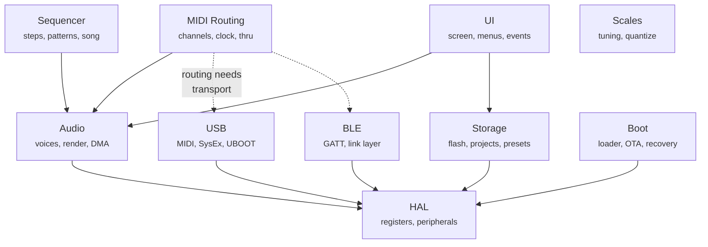
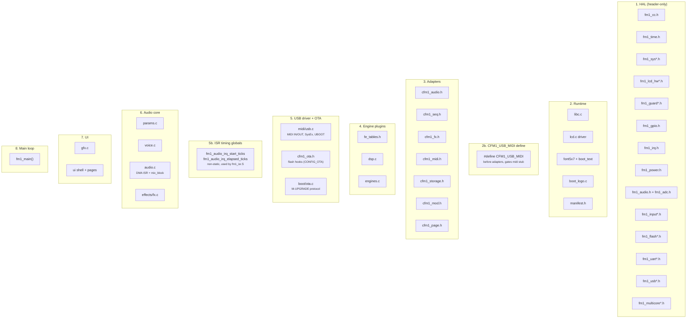
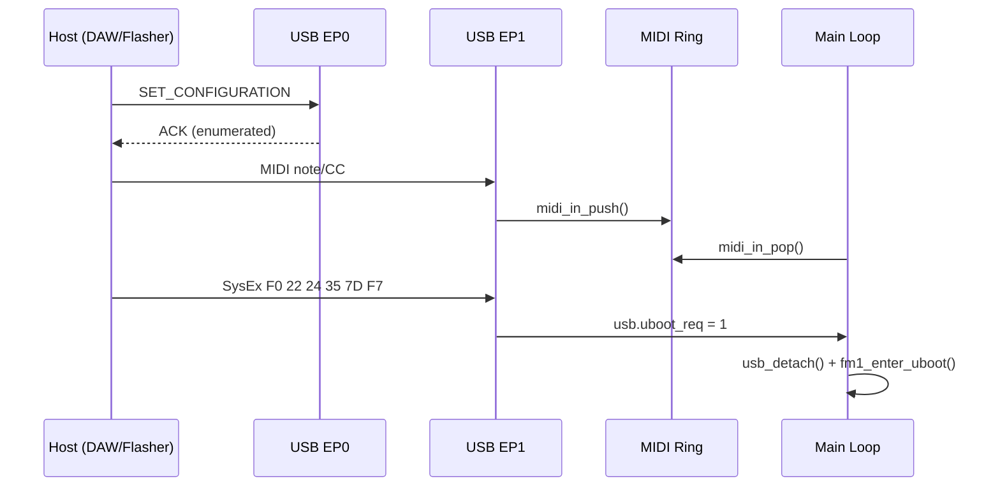
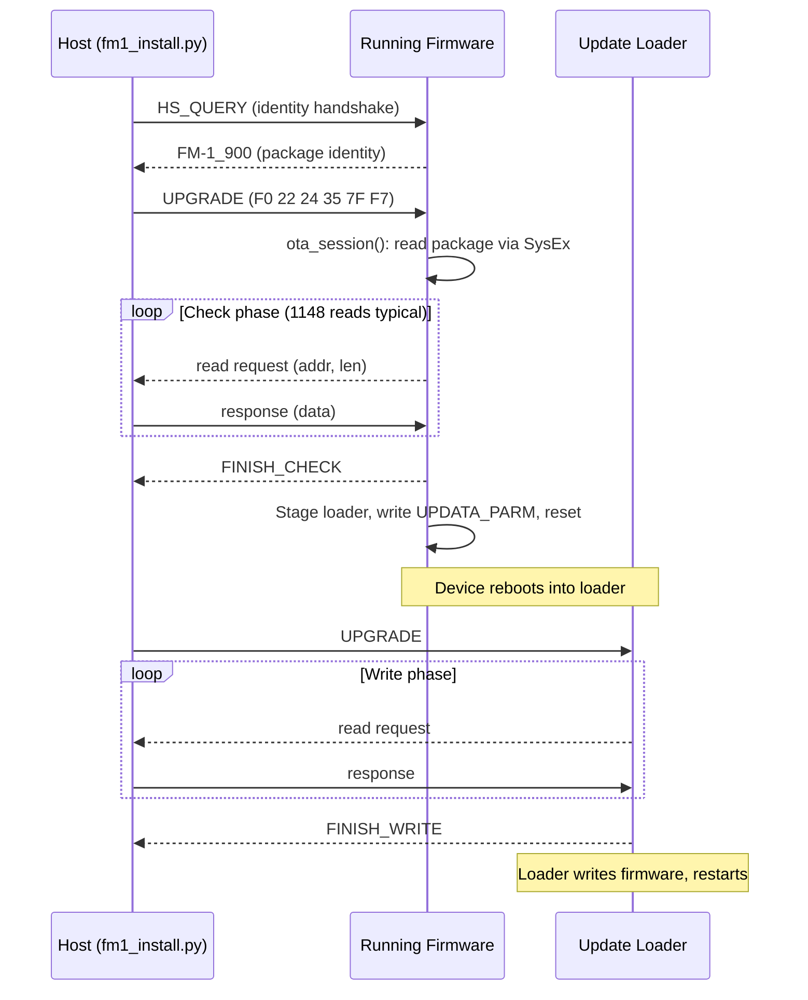
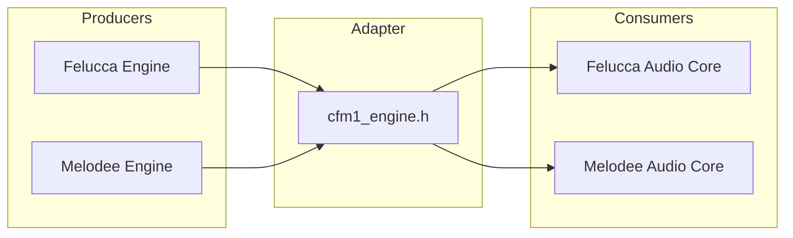

# Components

## Terminology

| Term | Meaning | Kconfig pattern | Example |
|------|---------|-----------------|---------|
| **Subsystem** | Architectural grouping with its own lifecycle | `CONFIG_AUDIO`, `CONFIG_USB` | Audio, HAL, USB, UI |
| **Module** | Functional slot within a subsystem | `CONFIG_ENGINE_FM6`, `CONFIG_SEQ_*` | FM6 engine, Effects, Sequencer |
| **Lineage** | Firmware-specific implementation of a module | `CONFIG_*_FELUCCA`, `CONFIG_*_MELODEE` | Melodee FX, Felucca Sequencer |

## Subsystem dependency graph



## Unity build inclusion order

Shows the `#include` order in `core_fm1.c`. Every `.c` is compiled into a single translation unit; all functions are `static`.



## HAL

Registers and low-level hardware access. Header-only. No logic, no state.

### Common (always included)

- `fm1_cc.h` (compiler intrinsics)
- `fm1_time.h` (tick counter, delays, watchdog)
- `fm1_gpio.h` (pin mux, read/write)
- `fm1_irq.h` (interrupt controller)

### Variant (pick one per slot via Kconfig)

| Variant slot | Felucca | SLOOP | Melodee |
|---|---|---|---|
| sys | yes | yes | yes |
| irq | yes | yes | yes |
| lcd | yes | shared w/ Melodee | yes |
| input | yes | yes | yes |
| guard | yes | yes | yes |
| flash | yes | yes | yes |
| uart | yes | shared w/ Felucca | yes |
| usb | yes | shared w/ Felucca | yes |
| timer | yes | shared w/ Felucca | yes |
| multicore | yes | yes | yes |

### Extensions (optional)

- **Melodee**: cache, clock, power, eq, led_pwm
- **Optimist**: ble_rf
- **Felucca**: led_anim

## USB

USB MIDI device class with SysEx protocol. Compiled independently of the audio core so that every firmware config can be reflashed over USB.

Enabled by `CONFIG_USB`. Always on in all defconfigs.

### What it provides

- USB enumeration (EP0 control, EP1 bulk MIDI)
- MIDI IN/OUT ring buffers
- SysEx assembly and dispatch
- **UBOOT soft key** (`F0 22 24 35 7D F7`): triggers bootloader entry for reflashing
- Optional CDC-ACM serial (`MELODEE_CDC`)
- Optional USB Audio class (`CONFIG_USB_AUDIO`, Melodee only)
- Optional OTA update over SysEx (`MELODEE_OTA`)

### Data flow



### Integration in the main loop

```c
// startup
usb_start();

// main loop
usb_poll();
usb_retry(fm1_ms);
if (usb.uboot_req) {
    usb_detach();
    fm1_delay_ms(30);
    fm1_enter_uboot();
}
```

### Source

- HAL: `firmware/hal/fm1_usb.h` (register-level, USB0 peripheral)
- Driver: `firmware/src/midi/usb.c` (~1000 lines, Melodee lineage)
- Adapter guard: `firmware/adapters/cfm1_midi.h` (`CFM1_USB_MIDI` flag avoids stub conflict)

## Audio

Voice allocator, render pipeline, DMA half-buffer (128 samples @ 44.1kHz stereo), mixer. The signal chain: main loop input scan -> page key handler -> voice allocator (`trk_note_on`) -> engine `note_on` -> DMA ISR calls `mix_block` -> engine `render` per voice -> I2S output.

Enabled by `CONFIG_AUDIO`. Requires `fm1_irq_enable_all()` after `audio_init()` or the ALNK0 DMA ISR never fires. Optionally uses `CONFIG_DUAL_CORE` for render on core 1.

### Audio Core (pick one)

- **Felucca**: 8+6 voices (14 total)
- **SLOOP**: inherited from Felucca
- **Melodee**: 18 budget units, FPU, per-voice cost (used by `felucca_mock` and `minimal` defconfigs)

### Engines (pick any combination)

Engines implement the `engine_t` vtable. Each compiles in/out independently via `CONFIG_ENGINE_*`.

#### Multiple lineages

- **FM6**: Felucca | Melodee (FPU, MARK I/MODERN/OPL modes)
- **Drum**: Felucca (GM) | SLOOP | Melodee (808/909/SID)

#### Felucca only

Analog (ported), Digital, Phase, Sample, Granular, LoFi, Trio, Tonewheel, Formant, Physical, Noise (ported)

#### Melodee only

Prophet-5, CZ-1, SID

### Effects (pick one)

- **Felucca**
- **SLOOP**
- **Melodee**

### Modulation (optional)

- 4-slot matrix

## Sequencer

Step sequencer, pattern management, recording. Depends on Audio.

### Implementation (pick one)

- **Felucca**: 64-step, chords, ties, live loop
- **SLOOP**: arranger, scenes
- **Melodee**: 64-step, 8 banks, 1024 notes, recording, undo, motion, song

## MIDI

Routing, clock sync, transport control.

Requires at least one transport: `CONFIG_MIDI_UART` (TRS) or `CONFIG_USB`.

### Routing (pick one)

- **Felucca**
- **SLOOP**
- **Melodee**: multi-channel, MPC pads, clock sources

### Transports

| Transport | Kconfig | Notes |
|-----------|---------|-------|
| UART (TRS DIN) | `CONFIG_MIDI_UART` | 31.25 kbaud |
| USB MIDI | `CONFIG_USB` | Class-compliant, SysEx |
| BLE MIDI | `CONFIG_BLE` | Via Optimist BLE stack |
| USB Audio | `CONFIG_USB_AUDIO` | Melodee only, stereo/4-track capture |

## BLE

Bluetooth Low Energy protocol stack. Depends on HAL (radio registers).
Enables BLE MIDI transport in the MIDI subsystem.

### BLE Stack (Optimist)

- Link Layer
- Host (L2CAP, ATT, SMP)
- GATT

### BT Classic (Optimist)

- BR/EDR (L2CAP, LMP, AVDTP)

## UI

Screen rendering, event dispatch, menu system.
Enabled by `CONFIG_INPUT`.

### UI Framework (pick one)

- **Felucca**: page-based shell with encoder/button dispatch
- **SLOOP**
- **Melodee**: Rubik font, track colors, 8 palettes, partial updates
- **Core**: minimal bitmap-font shell (default when no lineage UI is selected)

### Event flow

```
Hardware (key matrix, encoders, ADC)
  -> fm1_input_tick()           [Timer5 ISR, 10kHz]
  -> core_fm1.c::ui_input()     [main loop, 15ms frame]
    -> fsh_key(note, vel)        -> page->key()
    -> fsh_button(id, down)      -> hold lookup -> tap lookup -> page->button()
    -> fsh_knob(id, clicks)      -> page->knob() -> SELECT fallback
```

Button dispatch is hybrid: a centralized table (`cfm1_controls.h`) maps
button taps and holds to page names, and per-page `knob()`/`button()`/`key()`
handlers process encoder and keyboard input. The shell tries the page handler
first; if it returns 0 (unhandled), the shell falls through to the nav table.

### Source files (Felucca UI)

| File | Role |
|------|------|
| `firmware/adapters/cfm1_controls.h` | Button/encoder mapping tables (tap, hold, thresholds) |
| `firmware/adapters/cfm1_page.h` | Page vtable: name, draw, knob, button, key, enter, leave |
| `firmware/src/ui/felucca/ui.c` | Layout constants, includes all page files |
| `firmware/src/ui/felucca/shell.c` | Page array, navigation, input routing, draw loop |
| `firmware/src/ui/felucca/pages.c` | Page registration order |
| `firmware/src/ui/felucca/page_home.c` | HOME: engine select, track select, knob params, notes |
| `firmware/src/ui/felucca/page_params.c` | ENV, LFO, FX, SCL, EDIT, ARP, VOICE: 4-card param pages |
| `firmware/src/ui/felucca/page_seq.c` | SEQ: step sequencer display |
| `firmware/src/ui/felucca/page_mixer.c` | MIXER: per-track level controls |
| `firmware/src/ui/felucca/page_about.c` | ABOUT: firmware info (display only) |
| `firmware/src/ui/felucca/page_sys.c` | SYS: settings menu (conditional, `CONFIG_SYS_MENU`) |
| `firmware/src/ui/felucca/page_files.c` | FILES: USB disk browser (conditional, `CONFIG_UDISK`) |
| `firmware/src/ui/felucca/page_ble.c` | BLE: device list (conditional, `CONFIG_BLE`) |
| `firmware/src/ui/felucca/page_debug.c` | DEBUG: log viewer (conditional, `CONFIG_DEBUG_LOG`) |

### Felucca page order

HOME, ENV, LFO, FX, SCL, EDIT, ARP, SEQ, MIXER, VOICE, ABOUT, [SYS], [FILES], [BLE], [DEBUG]

Pages in brackets are conditional on their Kconfig symbol.

### Physical controls

#### Encoders

| ID | Name | HOME page | Param pages (ENV, LFO, etc.) | SYS | FILES | DEBUG |
|----|------|-----------|------------------------------|-----|-------|-------|
| 0 | SELECT | Engine select | Page nav (CW/CCW) | Cycle value | Scroll entries | Scroll log |
| 1 | ALGO | Track select | -- | Switch tabs | -- | -- |
| 2 | KNOB1 | Engine knob[0] | Param card 1 | -- | -- | -- |
| 3 | KNOB2 | Engine knob[1] | Param card 2 | -- | -- | -- |
| 4 | KNOB3 | Engine knob[2] | Param card 3 | -- | -- | -- |
| 5 | KNOB4 | Engine knob[3] | Param card 4 | -- | -- | -- |
| 6 | PRESET | -- | -- | Scroll rows | -- | -- |
| -- | MASTER | Volume (ADC) | Volume (ADC) | Volume (ADC) | Volume (ADC) | Volume (ADC) |

ALGO (ENC 1) has no knob handler on param pages: it is used only on HOME
(track select) and SYS (tab switch).

#### Buttons

| ID | Name | Tap action | Hold action (500ms) |
|----|------|-----------|-------------------|
| 0 | OCT- | **dead** | -- |
| 1 | OCT+ | **dead** | -- |
| 2 | FX | -> FX page | -- |
| 3 | SCL | -> SCL page | -- |
| 4 | ENV | -> ENV page | -- |
| 5 | LFO | -> LFO page | -- |
| 6 | EDIT | -> EDIT page | -- |
| 7 | GLO | -> DEBUG page (if `CONFIG_DEBUG_LOG`, else dead) | -- |
| 8 | HOME | -> HOME page | -> SYS page (if `CONFIG_SYS_MENU`, else ABOUT) |
| 9 | SAVE | **dead** | -- |
| 10 | ARP | -> ARP page | -- |
| 11 | SEQ | -> SEQ page | -- |
| 12 | PLAY | **dead** | -- |
| 13 | REC | **dead** | -- |

Dead buttons have no handler in the firmware. They reach `fsh_button()` but
are ignored (no tap nav, no hold nav, no page button handler).

#### Special hardware combos

- **OCT- + OCT+ held > 5 seconds**: reboots to UBOOT (in `core_fm1.c` main
  loop, bypasses the page system entirely)

### Parameter page card layout

Each param page shows 4 cards with values. The encoders map as:

| Card position | Encoder | `fparams_knob()` id |
|--------------|---------|-------------------|
| Card 1 | ALGO (ENC 1) | 1 |
| Card 2 | KNOB1 (ENC 2) | 2 |
| Card 3 | KNOB2 (ENC 3) | 3 |
| Card 4 | KNOB3 (ENC 4) | 4 |

### Param pages: card definitions

| Page | Card 1 | Card 2 | Card 3 | Card 4 |
|------|--------|--------|--------|--------|
| ENV | ATK (ms) | DEC (ms) | SUS (%) | REL (ms) |
| LFO | LFO (%) | RATE (Hz) | SHAPE (%) | DELAY (ms) |
| FX | DST (%) | CHO (%) | DLY (%) | REV (%) |
| SCL | ROOT | SCL | OCT | TRN |
| EDIT | eng edit[0] | eng edit[1] | eng edit[2] | eng edit[3] |
| ARP | MODE | TIME | RANGE (oct) | GATE (%) |
| VOICE | VCE | HOLD | GLD (ms) | UNI |

### HOME page card layout

HOME uses a different mapping. The engine's `knob[]` descriptor selects
which parameters appear:

| Card position | Encoder | Source |
|--------------|---------|--------|
| Card 1 | KNOB1 (ENC 2) | `engine->knob[0]` |
| Card 2 | KNOB2 (ENC 3) | `engine->knob[1]` |
| Card 3 | KNOB3 (ENC 4) | `engine->knob[2]` |
| Card 4 | KNOB4 (ENC 5) | `engine->knob[3]` |

## Storage

Flash storage, project save/load, presets.
Enabled by `CONFIG_FLASH`.

### Implementation (pick one)

- **Felucca**
- **SLOOP**
- **Melodee**: FBKG format, 384 presets, migration, backup/restore

## Scales

Scale selection, key quantization, tuning.

### Implementation (pick one)

- **Felucca**: 16 scales, white-key QNT
- **Melodee**: 70 scales incl. 54 microtonal, concert pitch 400-480Hz

## Boot

Startup, loader, OTA update mechanism.

### Implementation (pick one)

- **Felucca**: stock DFU
- **SLOOP**: stock DFU
- **Melodee**: M-UPGRADE SysEx OTA, boot protection, safe-recovery

## OTA

M-UPGRADE SysEx firmware update protocol. The running firmware reads the package from the host over USB-MIDI SysEx, stages the update loader in a dedicated flash area (0xE0000, 20 KiB), then reboots into it. The loader writes the new firmware and restarts.

Enabled by `CONFIG_OTA`. Depends on `CONFIG_BOOT_MELODEE` and `CONFIG_FLASH`.

### Protocol flow



### Source

- Protocol core: `firmware/src/boot/ota.c` (Melodee lineage, portable)
- Hardware hooks: `firmware/adapters/cfm1_ota.h` (flash ops, clock, progress display, commit)
- Wire transport: `firmware/src/midi/usb.c` (`ota_wire_send`, `ota_frame_get`, gated by `MELODEE_OTA`)
- Host tool: `firmware/upstream/felucca/tools/fm1_install.py`

## Adapters

Thin compatibility headers (`cfm1_*.h`) that let subsystems from different lineages plug into core-fm1. Each adapter defines the contract (types, vtable, signatures) that both sides conform to.



| Adapter | Header | Enables |
|---------|--------|---------|
| Audio Core | `cfm1_audio.h` | Common audio types and voice interface |
| Engine Plugin | `cfm1_engine.h` | Any engine on any audio core |
| Effects Chain | `cfm1_fx.h` | Swap FX implementations |
| Sequencer | `cfm1_seq.h` | Swap sequencer implementations |
| Storage | `cfm1_storage.h` | Tagged-blob project format |
| MIDI Routing | `cfm1_midi.h` | Swap MIDI implementations (`CFM1_USB_MIDI` gates stub) |
| Modulation | `cfm1_mod.h` | Swap modulation matrix implementations |
| Page/UI | `cfm1_page.h` | Page vtable for UI shell dispatch |
| OTA Update | `cfm1_ota.h` | Flash ops, clock, progress, commit hooks for `ota.c` |

## Defconfig presets

| Preset | Audio | USB | Engines | UI | Extras | Buildable |
|--------|-------|-----|---------|-----|--------|-----------|
| `minimal` | Melodee core + FX | yes | none | none | -- | yes |
| `core` | none | yes | none | Core shell | -- | yes |
| `core_fm1_dev` | Melodee core + FX | yes | FM6, Analog, LoFi, Trio, Noise, Stub | Felucca | BLE, OTA, storage, modulation, settings menu, USB disk | yes (29 components) |
| `felucca_noise` | Melodee core + FX | yes | Analog, Noise | Felucca | debug log, settings menu | yes |
| `felucca` | Felucca | yes | all Felucca | Felucca | -- | not yet |
| `melodee` | Melodee | yes | all Melodee | Melodee | -- | not yet |
| `sloop` | SLOOP | yes | Felucca set | SLOOP | -- | not yet |

All presets have `CONFIG_USB=y` so the device is always reflashable over USB.
