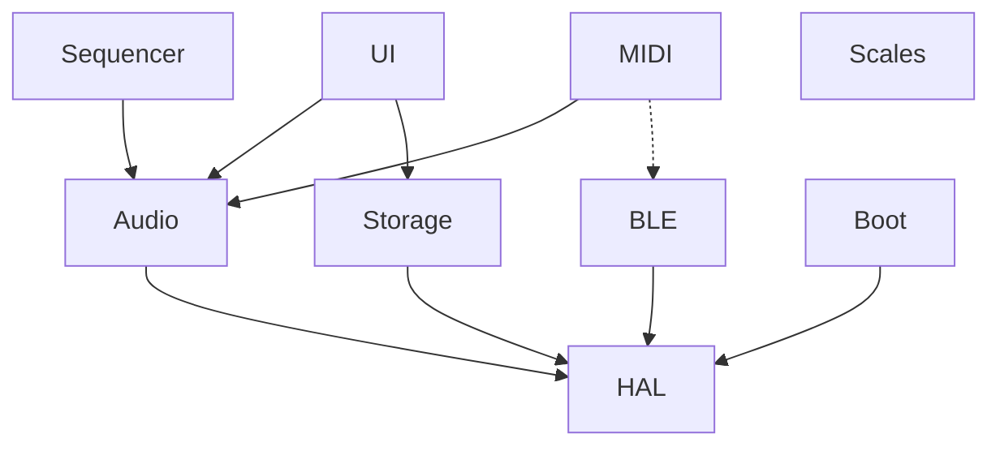

# Components

## Terminology

| Term | Meaning | Kconfig pattern | Example |
|------|---------|-----------------|---------|
| **Subsystem** | Architectural grouping with its own lifecycle | `CONFIG_AUDIO`, `CONFIG_BLE` | Audio, HAL, UI, BLE |
| **Module** | Functional slot within a subsystem | `CONFIG_ENGINE_FM6`, `CONFIG_SEQ_*` | FM6 engine, Effects, Sequencer |
| **Lineage** | Firmware-specific implementation of a module | `CONFIG_*_FELUCCA`, `CONFIG_*_MELODEE` | Melodee FX, Felucca Sequencer |

## Subsystems

## HAL

Registers and low-level hardware access. Header-only. No logic, no state.

### Common (always included)
- cc, time, gpio, xip, adc

### Variant (pick one per slot)
- sys
- irq
- lcd
- input
- guard
- flash
- uart
- usb
- timer
- multicore

| Variant slot | Felucca | SLOOP | Melodee |
|---|---|---|---|
| sys | yes | yes | yes |
| irq | yes | yes | yes |
| lcd | yes | shared w/ Melodee | yes |
| input | yes | yes | yes |
| guard | yes | yes | yes |
| flash | yes | yes | yes |
| uart | yes | shared w/ Felucca | yes |
| usb | yes | shared w/ Felucca | yes |
| timer | yes | shared w/ Felucca | yes |
| multicore | yes | yes | yes |

### Extensions (optional)
- **Melodee**: cache, clock, power, eq, led_pwm
- **Optimist**: ble_rf
- **Felucca**: led_anim

## Audio

Voice allocator, render pipeline, DMA half-buffer, mixer.
Enabled by `CONFIG_AUDIO`. Optionally uses `CONFIG_DUAL_CORE`.

### Audio Core (pick one)
- **Felucca**: 8+6 voices
- **SLOOP**
- **Melodee**: 18 budget units, FPU

### Engines (pick any)

#### Multiple lineages
- **FM6**: Felucca | Melodee (FPU, MARK I/MODERN/OPL)
- **Drum**: Felucca (GM) | SLOOP | Melodee (808/909/SID)

#### Felucca
- Analog
- Digital
- Phase
- Sample
- Granular
- LoFi
- Trio
- Tonewheel
- Formant
- Physical
- Noise

#### Melodee
- Prophet-5
- CZ-1
- SID

### Effects (pick one)
- **Felucca**
- **SLOOP**
- **Melodee**

### Modulation (optional)
- 4-slot matrix

## Sequencer

Step sequencer, pattern management, recording. Depends on Audio.

### Sequencer (pick one)
- **Felucca**: 64-step, chords, ties, live loop
- **SLOOP**: arranger, scenes
- **Melodee**: 64-step, 8 banks, 1024 notes, recording, undo, motion, song

## MIDI

Routing, clock sync, transport control.
Enabled by `CONFIG_MIDI_UART` (TRS) and/or `CONFIG_USB` (USB).

### Routing (pick one)
- **Felucca**
- **SLOOP**
- **Melodee**: multi-ch, MPC pads, clock sources

### Transports (enable any)
- UART (TRS)
- USB MIDI
- BLE MIDI
- USB Audio (Melodee only, stereo/4-track)

## BLE

Bluetooth Low Energy protocol stack. Depends on HAL (radio registers).
Enables BLE MIDI transport in the MIDI subsystem.

### BLE Stack (Optimist)
- Link Layer
- Host (L2CAP, ATT, SMP)
- GATT

### BT Classic (Optimist)
- BR/EDR (L2CAP, LMP, AVDTP)

## UI

Screen rendering, event dispatch, menu system.
Enabled by `CONFIG_INPUT`.

### UI Framework (pick one)
- **Felucca**
- **SLOOP**
- **Melodee**: Rubik font, track colors, 8 palettes, partial updates

## Storage

Flash storage, project save/load, presets.
Enabled by `CONFIG_FLASH`.

### Storage (pick one)
- **Felucca**
- **SLOOP**
- **Melodee**: FBKG format, 384 presets, migration, backup/restore

## Scales

Scale selection, key quantization, tuning.

### Scales (pick one)
- **Felucca**: 16 scales, white-key QNT
- **Melodee**: 70 scales incl. 54 microtonal, concert pitch 400-480Hz

## Boot

Startup, loader, OTA update mechanism.

### Boot (pick one)
- **Felucca**: stock DFU
- **SLOOP**: stock DFU
- **Melodee**: M-UPGRADE SysEx OTA, boot protection, safe-recovery

## Defconfig presets

| Preset | Description | Buildable |
|--------|-------------|-----------|
| `minimal` | LCD boot splash only, no subsystems | yes |
| `felucca` | Pure Felucca: all Felucca lineage | not yet |
| `melodee` | Pure Melodee: all Melodee lineage | not yet |
| `sloop` | Pure SLOOP: SLOOP + inherited Felucca lineage | not yet |
