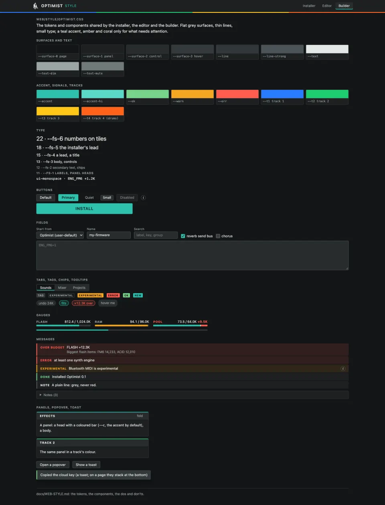
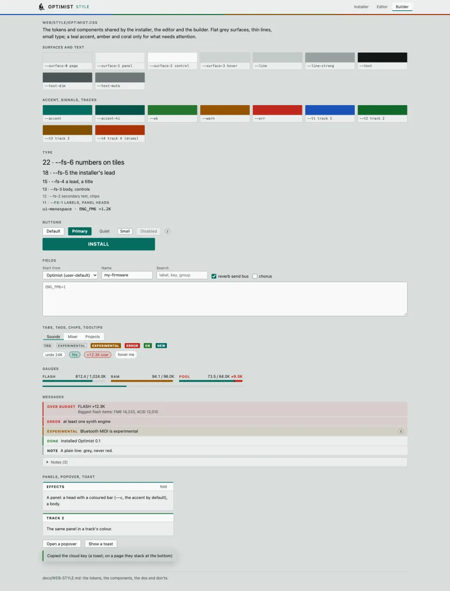

# The web style

The installer, the editor and the builder share one look: `web/style/optimist.css`, tokens and components only.
`web/make_site.py` puts it into each page where the page says `/*OPTIMIST-CSS*/` (inside a `<style>`), and the shared
header where it says `<!--OPTIMIST-HEADER-->`, so every page stays one standalone file that works offline. A page's own
layout stays in the page. `web/style/gallery.html` shows every component (open it from a checkout; it is not on the
site).

The idea is Ableton Live's: flat, dense, neutral grey surfaces, thin separators, small type, a coloured bar on top of a
thing's head, a clear order of panels. The colours are the sea's: a teal accent, amber and coral only for what needs
attention. Light and dark follow the system (`prefers-color-scheme`); there is no switch.

## Tokens

| Token | Use | Dark | Light |
| --- | --- | --- | --- |
| `--surface-0` | the page | `#141617` | `#d9dedd` |
| `--surface-1` | a panel, the header | `#1d2021` | `#eceeed` |
| `--surface-2` | a control, a panel's head | `#282c2d` | `#f8f9f9` |
| `--surface-3` | hover, pressed, an empty bar | `#343a3b` | `#ccd3d1` |
| `--line`, `--line-strong` | separators; control borders | `#31373a`, `#4b5356` | `#c2c9c7`, `#98a2a0` |
| `--text`, `--text-dim`, `--text-mute` | text; secondary; the quietest (keys, hints) | `#e3e8e6`, `#9aa5a3`, `#6f7a78` | `#121716`, `#4b5554`, `#6d7776` |
| `--accent`, `--accent-hi`, `--on-accent` | the primary action, the current thing, a fill that is fine | `#2fc1ae`, `#5ad8c7`, `#04211d` | `#066b60`, `#04524a`, `#ffffff` |
| `--ok` | done, connected | `#78d38a` | `#26742f` |
| `--warn` | experimental and on, nearly full | `#f5a524` | `#965400` |
| `--err`, `--on-signal` | stops a build or an install, over budget; text on a signal fill | `#ff5d4f`, `#170806` | `#bf271e`, `#ffffff` |
| `--t1` ... `--t4`, `--on-track` | the four tracks (the editor's and the FM-1's): blue, green, yellow, orange | `#287cff` `#1ecc70` `#ffc618` `#ff621a` | `#1a52b8` `#11682b` `#825000` `#ab3207` |

Text on its surfaces has a contrast of at least 4.5 in both schemes (`--text-mute`: about 3.7, for quiet text only).
The scale: type `--fs-1` ... `--fs-6` (11, 12, 13, 15, 18, 22 px; the body is 13), spacing `--sp-1` ... `--sp-6` (4, 8,
12, 16, 24, 32 px), `--r` 3 px corners, `--ctl-h` 26 px controls (34 px for a finger), `--bar-h` 3 px coloured bars.
Fonts: `--font-ui` (the system's sans) and `--font-mono` (numbers that line up, keys, files).

## Components

- **Header** `.o-head`: the dinghy and the name (to the site's root), the app's name in the accent, the links between
  the three apps (`.o-nav`, the current one `aria-current="page"`), and `.o-tracks`, the four track colours under it.
  `make_site.py shared_header(app)` writes it.
- **Page** `.o-page`: one column, `--page-w` wide at most, 16 px gutters.
- **Buttons** `.o-btn` (or any `button` inside `<body class="o-ui">`): default, `.primary` (one per view), `.quiet`,
  `.sm`, `.big`. **Fields** `.o-select`, `.o-input`, `.o-check`, `.o-field` (a label over its control).
- **Info** `.o-info`: the round (i) that opens a popover. **Popover** `.o-pop` on a `[popover]` element.
  **Tooltip** `data-tip="..."`: one line, on hover and keyboard focus.
- **Tabs** `.o-tabs` (`aria-selected="true"` or `.on`), **tags** `.o-tag` (`.outline .accent .ok .warn .err`),
  **chips** `.o-chip` (`.accent .err`).
- **Panel** `.o-panel` with `.o-panel-h` (a coloured bar on top: `--c`, the accent by default) and `.o-panel-b`.
- **Message** `.o-msg` (`.err .warn .ok`, plain): one line, a short head in `<b>`, details in `.sub`.
  **Disclosure** `.o-details`.
- **Gauge** `.o-gauge` (`data-state="ok | tight | over"`): `.gl` label, `.gn` used / limit with `.go` the overflow,
  `.gb` the bar with `.gf` the fill, `.gx` the overflow and `.gc` the limit's mark. **Progress** `.o-progress`.
- **Toast** `.o-toast` inside one `.o-toasts`: says what just happened, then goes.

## Dos and don'ts

- Red is for what stops a build or an install (an error, an overflow); amber for what is experimental and on, or
  nearly full. Everything else is grey: credits, provenance, "tested in the emulator only" go in an (i) popover or a
  closed "Notes (n)", never in a coloured bar, and the same text is said once.
- One primary button per view. The accent marks the current thing and what is fine; it is not decoration.
- The track colours mean the tracks. Do not use them for states.
- Dense, not cramped: 13 px body, 4 px steps; numbers in `font-variant-numeric: tabular-nums`.
- Tokens, never raw colours, in a page's own CSS. A new colour starts as a token here, with its light value.
- No theme switch and no `data-theme`: the system decides.
- Phones: no sideways scroll, 16 px gutters, 16 px text in fields (no zoom on focus), larger hit areas under
  `pointer: coarse`.

## A mounted module's layout

A module that can be mounted in another page (the installer, `web/installer/installer.css`, scoped to `.oi`) keeps its
layout in its own file and takes every colour, size and font from the tokens above, never a value of its own, so it has
the look of whatever page holds it (the standalone installer, or a tab of the editor). `web/test_web.mjs` checks that
the installer's CSS has no colour literal.
